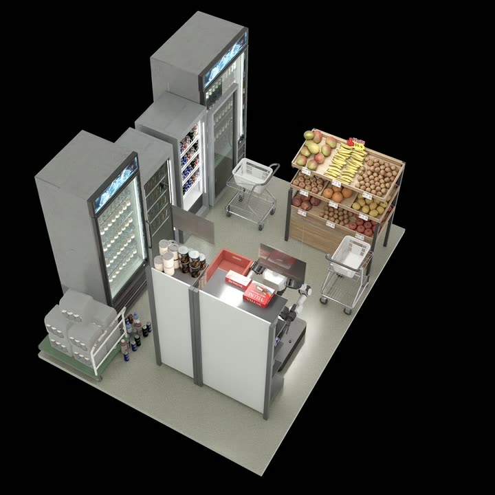
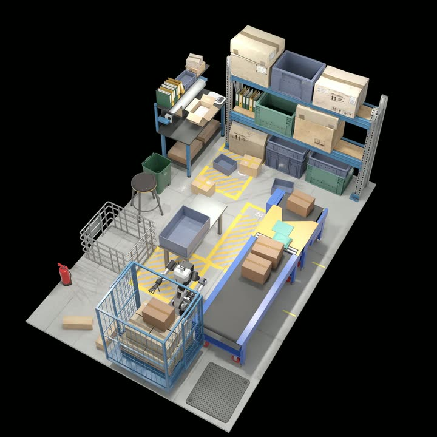
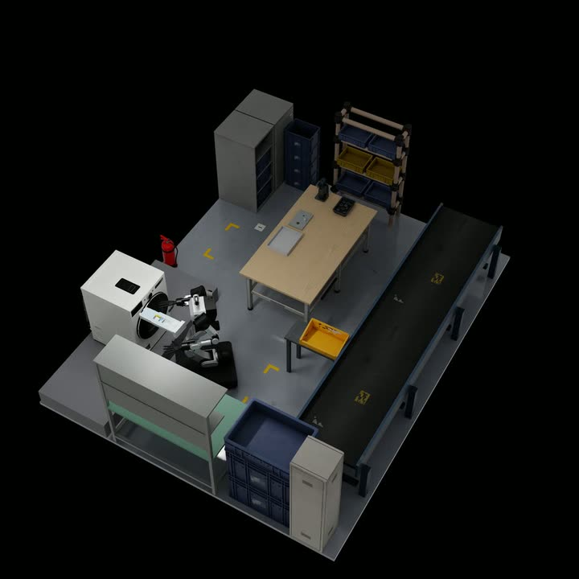
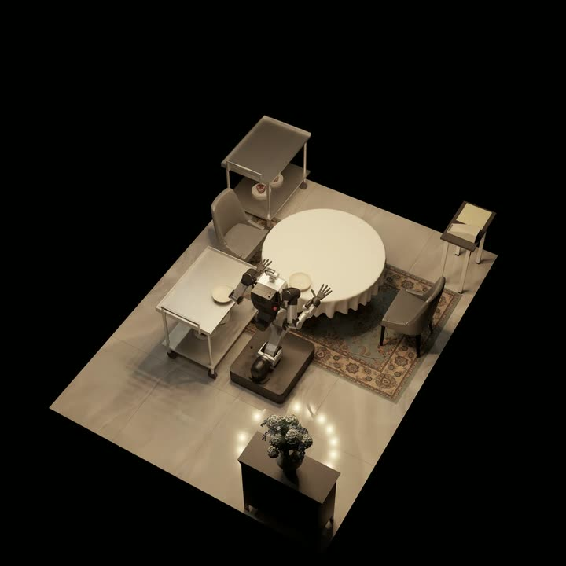

<h1 align="center">DexBench</h1>

<strong>Measuring dexterity where it matters.</strong>

  <a href="https://dexbench.ai/">
    <picture>
      <source media="(prefers-color-scheme: dark)" srcset="docs/media/dexbench/rlwrld-dark.svg">
      
    </picture>
  </a>

  
  
  
  
  
  
  

https://github.com/user-attachments/assets/215a0ed3-2d89-4b14-a2c9-0ecd34658131

**DexBench evaluates dexterous manipulation across 15 tasks in four industrial environments.**
Built on IsaacLab-Arena with Newton physics, it brings five-finger, bimanual manipulation
into retail stores, logistics centers, manufacturing lines and hotel service spaces.

- **Real work, full scenes.** Cluttered shelves, moving conveyors, tight insertions and tool use.
- **Diverse physical interactions.** Rigid objects, contact-rich manipulation, deformable bags and paper, and liquids.
- **Reproducible evaluation.** Frozen start states and task-specific tests of object, spatial and physical generalization.

## Environments

<table>
  <tr>
    <td align="center" width="25%"> <strong>Retail</strong> 3 tasks · Picking &amp; placement</td>
    <td align="center" width="25%"> <strong>Logistics</strong> 4 tasks · Sorting &amp; packing</td>
    <td align="center" width="25%"> <strong>Manufacturing</strong> 5 tasks · Assembly &amp; fastening</td>
    <td align="center" width="25%"> <strong>Hotel F&amp;B</strong> 3 tasks · Stacking &amp; serving</td>
  </tr>
</table>

Explore [all tasks and demonstrations](https://dexbench.ai/#tasks) on the website.

## Get started

### Installation

This release includes **evaluation and OpenXR teleoperation**. Training datasets are
available on Hugging Face; data-generation and model-training scripts are not included.

1. **Set up the simulator** — follow [Getting started](docs/Getting_Started.md) to clone the repo, download assets and evaluation data, and build the Docker image.
2. **Connect your policy** — use the [policy integration guide](scripts/evaluation/eval_launch/CONNECT_YOUR_POLICY.md).
3. **Run and score** — follow the [evaluation quickstart](scripts/evaluation/eval_launch/QUICKSTART.md).

The simulator needs an NVIDIA GPU with RT cores; the policy server can run on a separate machine.

### Run on Manifold

To avoid downloading assets, building Docker images and finding an RT-core GPU, run DexBench
on [Manifold](https://docs.manifold.bifrost.ai/benchmarks/dexbench). A single command splits
the evaluation across parallel cloud GPUs, connects to your policy wherever it runs, and
returns results with failure analysis and episode replays. At launch, your first DexBench
runs are free.

## Resources

| Resource | Contents |
| :-- | :-- |
| [Evaluation protocol](docs/Eval_Protocol.md) | Generalization cells, episode caps and scoring |
| [Datasets](https://huggingface.co/datasets/RLWRLD/DexBench-datasets) | Per-task and multitask demonstrations in LeRobot v3.0 format |
| [Teleoperation](docs/Getting_Started.md#6-teleoperate-with-a-meta-quest-over-openxr) | Meta Quest setup and demonstration recording |
| [Leaderboard submissions](docs/Leaderboard_Submission.md) | Required results and submission format |
| [Manifold](https://docs.manifold.bifrost.ai/benchmarks/dexbench) | Hosted DexBench evaluation on cloud GPUs, with failure reports and episode replays |

## License

RLWRLD-authored code is licensed under [Apache-2.0](LICENSE); see [NOTICE](NOTICE).
Assets, datasets, models and runtime binaries retain their own terms.
See [asset attribution](https://huggingface.co/datasets/RLWRLD/DexBench-assets/blob/main/ASSET_LIST.md) for the asset-specific notices.
