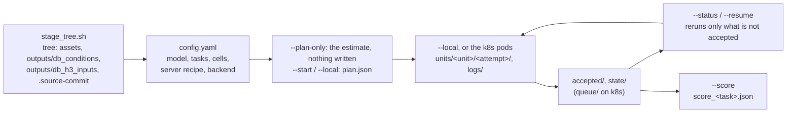
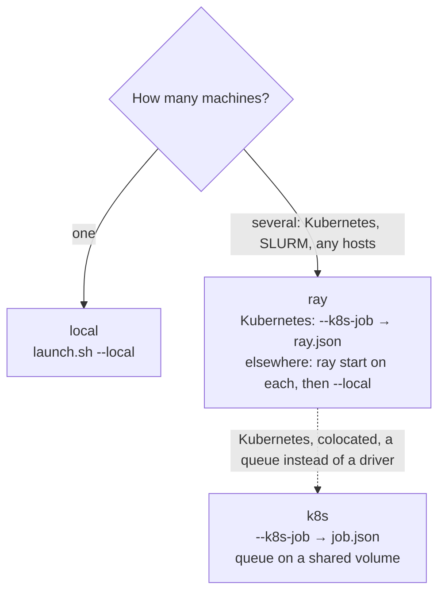
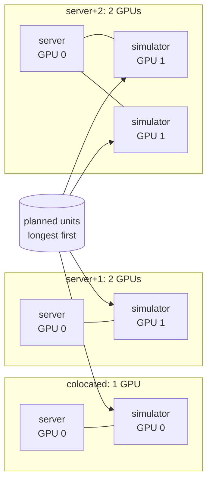
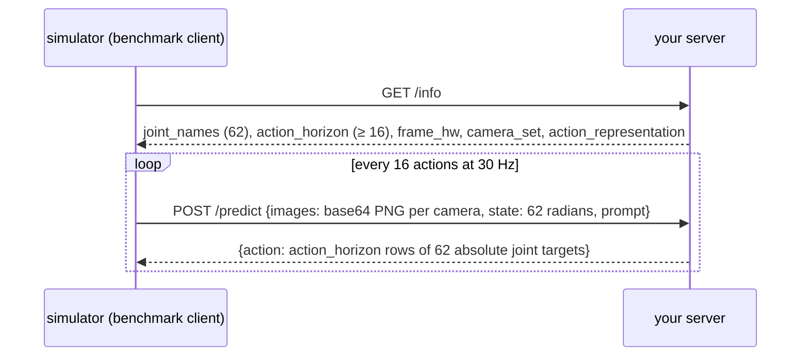

# Eval launcher: quickstart

From a checkpoint to a DexBench score. Commands run from the repository root in one of two places: **on the host**,
as your normal user (git, the asset download, staging, `kubectl`, and planning), or **in the simulator image** (the runs).
Never write `assets/` from inside a container. [USER_GUIDE.md](USER_GUIDE.md) is the full reference, and
[CONNECT_YOUR_POLICY.md](CONNECT_YOUR_POLICY.md) covers a model of your own.

## Before you start

- **On the host:** git, python3 with PyYAML, and the `hf` CLI (`pip install huggingface_hub`), logged in with
  a token that can read the datasets repositories (`hf auth login`).
- **The simulator image**, built on the host from the recipe in docker/README.md: its
  two `git submodule update` lines, then `python3 docker/build.py`. Start it with that file's `docker run`
  line, which mounts `assets/` read-only and `outputs/` from the host: the image holds the source as it was built, so
  a config you write later goes under `outputs/`.
- **NVIDIA L40S GPUs (46 GB).** These are the only GPUs the pipeline was verified on, and the costs in `timings/`
  were measured on them.

`launch.sh` runs `ISAAC_PYTHON` when it is set, else Isaac Sim's Python in the image, else `python3`: `--plan-only`,
`--k8s-job` and `--status` work on the host; `--local`, `--resume`, `--smoke` and `--score` (which needs scipy) run in
the image, and `launch.sh` refuses them on a host's `python3`.

## 1. Stage the tree, once per commit (on the host)

A launch runs from one checkout, which must hold the assets' payloads and the benchmark's frozen inputs. On a
cluster, build it on the shared volume from a host that mounts it, as your normal (non-root) user (it clones your
checkout's `origin`; `--repo <url>` names another):

```bash
scripts/evaluation/eval_launch/stage_tree.sh <commit> <volume>/<you>/trees/<12-char commit>
```

On one host, your checkout can be the tree:

```bash
./scripts/download_assets.sh
./scripts/download_datasets.sh --eval-conditions   # outputs/db_conditions/ and outputs/db_h3_inputs/, each checked
```

## 2. Pick a path

**A. One machine** (`backend.kind: local`). Start from `examples/own_policy_local.yaml`, which runs as it is: the
server kit's `HoldPose` example (it holds the robot still) on Retail - Task 2's train cell, so the whole chain runs before any
model of yours. On the host, copy it under `outputs/` (which the image mounts and git ignores) and set its
`checkpoint` to a directory the image sees (e.g. under `outputs/`; the recipe's setup checks it exists) and its
`backend.gpus` to your GPUs:

```bash
mkdir -p outputs/configs && cp scripts/evaluation/eval_launch/examples/own_policy_local.yaml outputs/configs/my_eval.yaml
```

Then, in the simulator image:

```bash
L=scripts/evaluation/eval_launch/launch.sh; C=outputs/configs/my_eval.yaml
$L $C --plan-only   # units, GPU-hours and wall time; writes nothing
$L $C --local       # plan, place the stations, run every unit
$L $C --status      # what is done, running, failed, and why
$L $C --resume      # after any stop: accepted units never run again
$L $C --score       # score_<task>.json from the accepted attempts only
```

`examples/single_task_local.yaml` is the same for a registered model (GR00T): it also needs that model's client in
the image (docker/README.md, "Optional GR00T remote-policy client") and its server's environment where the recipe names it.

**B. Kubernetes with Ray** (`backend.kind: ray`). On the host, copy `examples/ray_kubernetes.yaml` and the site profile
`examples/sites/kubernetes.yaml` side by side (e.g. to `configs/local/`, which git ignores), fill the profile's `<...>`
with your cluster's image, namespace, volume and node rules, and point the config's `backend.site` at your copy (left
as it is, it names the example profile, whose placeholders `--k8s-job` refuses). Set `backend.k8s.tree_dir` and
`commit` to the staged tree. The example's model is GR00T, whose client the default image lacks and whose server needs
its own environment on the volume (as path A says); for your own model, use path C's model block and recipe. Then, on
a host that sees the volume and has `kubectl`:

```bash
L=scripts/evaluation/eval_launch/launch.sh; C=<your copy>.yaml
$L $C --plan-only                        # also checks the staged tree for the inputs the tasks read
$L $C --k8s-job jobdir/                  # jobdir/ray.json, prepull.json, eval.yaml
mkdir -p <output>/launches               # the launch's output directory, on the volume
cp jobdir/eval.yaml <output>/eval.yaml   # the pods read the config from there
cp -r jobdir/launches/. <output>/launches/   # this start's record
kubectl apply -f jobdir/prepull.json     # optional: pull the image onto the nodes first, then delete it
kubectl apply -f jobdir/ray.json         # the head runs the driver; workers join it
$L $C --status                           # from any machine that sees the volume
$L $C --score                            # in the image, with the volume mounted (it needs scipy)
```

**C. Your own model.** Serve it with the server kit (`source/dexbench_policy_server`): put your model in place of
`HoldPose` in path A's config (`model.policy` registers it, the recipe's `command` starts its server), and follow
path A. Before a full launch, `$L $C --smoke` runs one station for a few rows and checks frames, timing and GPU memory.
[CONNECT_YOUR_POLICY.md](CONNECT_YOUR_POLICY.md) walks through all of it.

## How a launch flows



Which backend:



A station is one policy server and its simulators, placed by `servers.layout`. The driver hands each free
simulator slot the next unit, and the server keeps its checkpoint loaded between units:



What your server answers. Both requests carry `Authorization: Bearer <token>`, read from the file passed as
`--token-file`:



## Where the results are

```
<output>/
  plan.json                  # units, costs, estimate
  launches/<time>-<id>/      # each start: the resolved config, the command, the source commit
  accepted/<unit>.json       # local, ray: the attempt each unit is scored from
  units/<unit>/<attempt>/    # one run_benchmark_cell.py output per attempt; <attempt>.log beside it
  logs/                      # policy server and slot logs
  score_<task>.json          # --score
  retries_<task>.json        # --score: accepted units that failed an attempt first; read before a headline
```

## Three common errors

| You see | Fix |
|---|---|
| `refusing to plan: <tree> lacks what the planned tasks read: ... run scripts/download_datasets.sh --eval-conditions` | Run that command in the tree, or stage it with `stage_tree.sh`. `--plan-only` prints the same list as a note. |
| A unit fails with `<episode> camera_...: N/N blank` (black frames) | The renderer is starved, usually on a GPU that is not an L40S or with too many simulators on one GPU. Run on L40S, use `colocated` or `server+1`, and check a layout with `--smoke` first. |
| `<output>: another driver holds <output>/state/driver.lock; one driver per launch` (exit 75) | A driver for this launch is still running. Its host and pid are in `<output>/state/drivers/`. Wait for it, or stop exactly that process, then `--resume`. |
