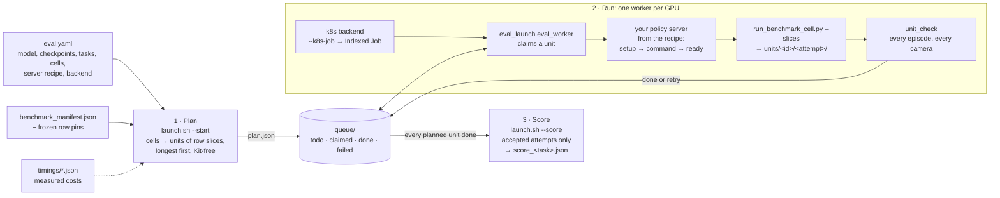
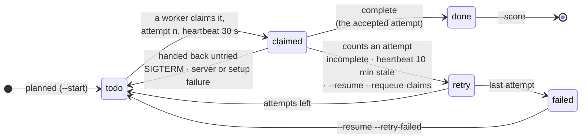

# Eval launcher

New here? Start with [QUICKSTART.md](QUICKSTART.md): stage, plan, run, score, in one screen.

Runs a model's whole benchmark evaluation from one config, as fast as the GPUs allow.

It ships with the benchmark (`scripts/evaluation/eval_launch/`, run as `launch.sh` or `python -m eval_launch` with
`scripts/evaluation` on the path). A cluster's settings are a site profile (`site.py`); the examples are a local
machine's and a plain Kubernetes cluster's.

## What it does

How to run, resume and score a launch: [USER_GUIDE.md](USER_GUIDE.md). How to put your own model on it:
[CONNECT_YOUR_POLICY.md](CONNECT_YOUR_POLICY.md).

- Plans a model's evaluation from the benchmark manifest: every cell cut into units of row slices, sized to about
  15 minutes, with an estimate of GPU-hours and wall time from measured costs (`timings/`).
- Runs the units on one machine (`local`), on Ray (`ray`, several machines or pods of a Kubernetes cluster), or as a
  Kubernetes Indexed Job (`k8s`), each unit a `run_benchmark_cell.py` call beside the model's policy server.
- Accepts a unit only when every episode ran and every camera rendered; a crashed attempt keeps the episodes it
  finished (`local`, `ray`), and a stopped launch resumes without rerunning anything accepted.
- Scores the accepted attempts with the benchmark scorer.


A cluster's settings (image, namespace, volume, node rules, pod sizes) are a site profile (`backend.site`, `site.py`;
`examples/sites/kubernetes.yaml` for a plain cluster). Configs with real values
(checkpoints, runs) go in `outputs/configs/` (git ignores it, and the simulator image mounts it), or `configs/local/`
for a config only the host reads (`--k8s-job`); `examples/` holds a local machine's and a Kubernetes
cluster's with placeholders. Every start of a launch records the config it resolved, its
source commit and, for `--k8s-job`, the rendered manifests under `<output>/launches/` (USER_GUIDE.md, "Where things
are").

## How a launch flows

The launcher plans units from the manifest, and the scorer reads only the attempts the launch accepted. On `k8s`,
workers pull the units from a queue on a shared filesystem and run each with `run_benchmark_cell.py` (below); on
`local` and `ray`, one driver hands them to its stations and records what counts (`acceptance.py`, USER_GUIDE.md).



A unit's life in the queue. The queue directory is the launch's whole state, so a stopped launch resumes from it:
a `done` unit never runs again, and only one attempt per unit is ever scored.



## Why not Arena's experiment runner or its OSMO workflow

Each unit is one `run_benchmark_cell.py` call, which runs Arena's experiment runner unchanged; the launcher only
decides which rows run where and when. Arena's multi-node path (`osmo/submit_arena_experiment.py`) schedules one task
per Run, each with its own policy server. It does not fit here, for four reasons:
- The units are row slices inside a Run. An Logistics - Task 1 Run of 30 rows is about 2.5 h at worst, so per Run the slowest GPU
  sets the finish time.
- A colocated server is loaded once per worker and kept for every unit of its checkpoint.
- The clusters it was built for are plain Kubernetes, without OSMO.
- A Run per task with its server needs twice as many GPUs as Runs.

Neither Arena main nor an open upstream PR has a queue, resume or claim fencing inside one experiment (checked
against Arena main e87874def).

## Use

```bash
scripts/evaluation/eval_launch/stage_tree.sh <commit> <dest>         # a launchable tree from the published sources
scripts/evaluation/eval_launch/launch.sh <config> --plan-only        # units and the estimate
scripts/evaluation/eval_launch/launch.sh <config> --local          # run on this host (backend.kind: local or ray)
scripts/evaluation/eval_launch/launch.sh <config> --resume         # continue a stopped launch (k8s: --requeue-claims)
scripts/evaluation/eval_launch/launch.sh <config> --k8s-job <dir>    # Kubernetes: job.json (ray.json for Ray), prepull.json
scripts/evaluation/eval_launch/launch.sh <config> --status
scripts/evaluation/eval_launch/launch.sh <config> --score
scripts/evaluation/eval_launch/launch.sh <config> --smoke          # before a launch: one station, frames, timing, GPU memory
```

Costs come from `timings/l40s_example.json` (per task: `slowdown`, wall time over simulated time, and
`build_s`, measured on L40S GPUs); `--timings <file>` names another. A task with no measurement takes the median of
the measured ones, and the plan says so.

## Rules

- The launcher names no task. Everything about a task comes from the benchmark manifest, so a task is in a plan
  as soon as its spec is (`test_a_task_added_to_the_spec_is_planned_with_no_launcher_change`).
- A unit is one `run_benchmark_cell.py` call over row slices of one cell (`model_run.prepare`'s slices); every
  row of a planned cell is in exactly one unit.

## Tests

```bash
/isaac-sim/python.sh -m pytest scripts/evaluation/eval_launch/tests
```

The driver's tests (`test_driver.py`) run each case on both executors with fake GPUs: the local one always, the Ray
one on a local Ray instance, skipped when Ray is not importable (`ray==2.58.1`, installed by the CI job's Ray run and
by the simulator image's recipe, `docker/Dockerfile`).

CI runs them on every pull request (`.github/workflows/eval-launcher-tests.yml`), Kit-free, with PyAV and Arena's
two Kit-free modules (the experiment result and the episode result files) taken at the submodule's pin.
